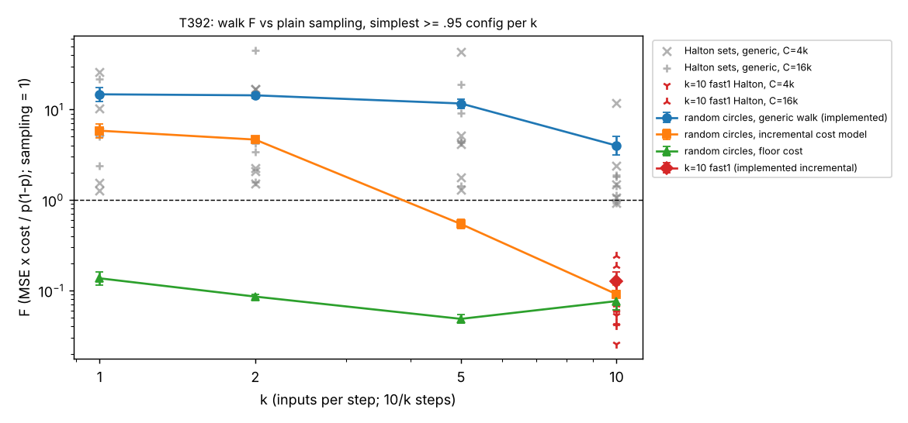

# T392: chunked-input RNN, depth (k = 1) versus width (k = 10)

↑ [Approaches](../README.md) · [TASKS](../../../TASKS.md) · [INDEX](../../../INDEX.md)

Owner: Claude child session_01GcE8ZjdR1c4eu64CzHuyve, branch `claude/t392-chunked-rnn` (owner idea 06:0x).

## Question

ARC's M_16,10 reads one input per step for 10 steps (k = 1, deep in time). The all-at-once network of T345 (one hidden
layer of 128 comparator-like units) is the other extreme (k = 10, wide). An RNN that reads k numbers per step for
10 / k steps (k = 1, 2, 5, 10) interpolates between them. How does the difficulty of ARC's challenge (estimate the
accuracy from the weights, at least as precisely as sampling at equal compute) change between depth and width?
Concretely, per k: the smallest width reaching >= .95, its fragmentation (gate patterns), and the figure of merit F of
exact great-circle walks (random and fixed Halton sets) against plain sampling at equal forward-pass cost.

## Pre-registration (written and pushed before any training run, 2026-10-19)

### Model and task
- Task: alg_zoo `2nd_argmax`: x ~ N(0, I_10), label = `x.argsort(-1)[..., -2]` (position of the 2nd-largest input;
  alg_zoo/tasks.py). Accuracy = P(argmax logits == label).
- Model `k{K}h{H}` (`train.py`): torch `nn.RNN(input_size=k, hidden_size=H, nonlinearity="relu", bias=False)`, input
  reshaped to (S = 10/k steps, k) with consecutive positions per chunk (step t reads x[(t-1)k : tk]), h_0 = 0, logits =
  `Linear(H, 10, bias=False)` of the final hidden state. k = 1 is alg_zoo's DistRNN (M_16,10 = k1h16); k = 10 has one
  step, so W_hh is unused and the net is exactly T345's D1wH MLP.
- Recipe = alg_zoo `training.train`: AdamW (weight decay .001), lr .04/sqrt(H), 2^14 warm-up steps, exponential decay
  to .01x, batch 1024, cross-entropy, n_train = 2^30 fresh samples, `torch.manual_seed(seed)`, CPU, one thread per run.
- FPE (one forward pass of that net, in FLOPs; 2 per multiply-add, 1 per ReLU): 2 (10 H + (S - 1) H^2 + 10 H) + S H. The
  first step's W_hh h_0 is skipped (h_0 = 0); for k = 1 the T345 convention (which charges it) is also reported.

### Step 1: width ladder per k
- k in {1, 2, 5, 10}; H rungs 16, 24, 32, 48, 64, 128 (extended with 192, 256 if 128 fails).
- Seeds 0, 1, 2. A rung passes only if all 3 seeds reach >= .95; so seed 0 is trained first and seeds 1-2 only if seed 0
  passes (a failing seed 0 already fails the rung). The ladder for a k stops at the first passing rung = the
  **simplest passing config** for that k. Higher rungs may be started speculatively for CPU use; they do not change the
  selection. Scheduler: `ladder.py`.
- Accuracy of every trained model on 1e7 fresh inputs (numpy, seed 392001) with binomial SE; the decision uses this
  number.
- Cross-check for k = 10: T345's 2^30 D1w64 / D1w80 / D1w96 / D1w128 accuracies (.60 / .66 / .97, .90, .97 / .99 x 3).

### Step 2: on the simplest passing config per k
- Gate patterns: distinct full gate patterns (all S steps) in 1e7 inputs (seed 392002, 64-bit hashes), per-step
  cumulative counts, and the share seen once.
- Panel: the 3 seeds plus 3 noised copies per seed (relative sigma .001 x RMS per matrix, noise rng seed 392), 12
  models, as T345 Amendment B. Truth per model: 1e8-sample MC (seed 392003); its SE is reported.
- Walks: exact great-circle walks. x(theta) = u cos theta + v sin theta; by homogeneity the circle is the two lines
  +-(u + t v) with Cauchy weight; the correct set on each is a finite union of intervals, integrated exactly.
  - Generic implementation for all k (`cwalks.py`): `walks.walk` from T345 (`ffn_control/walks.py`, copied unchanged with
    its sha256 asserted) with a chunked-RNN model class (pre-activations and slopes at each piece). Costs charged as
    T345: `F` = implemented (one forward-with-slope = 2 FPE per piece + target/envelope/erf work), `F_incr` = incremental
    cost model (after a gate flip at step t: a rank-1 update into step t+1, then a value+slope recompute of the later
    steps and the readout; a model, not implemented), `F_floor` = 4 x 10 FLOPs per piece + aux + 2 FPE per walk.
  - For k = 10 also T345's `fast1.py` (incremental, implemented; copied unchanged, sha256 asserted).
  - Validation before scoring: (i) my k = 10 model class reproduces `walks.MLP` and `fast1.circle` on T345's D1w128_s0
    weights (same values, 20 circles, |diff| < 1e-8); (ii) my k = 1 class reproduces `walks.RNN` on a k = 1 model.
- (a) Random great circles (sampling-class): F = mean_m(Var_m c_m) / mean_m p_m(1 - p_m) with a 95% bootstrap CI over the
  12 models (budget-free for C >> c_m), from >= 1000 circles per model (fewer if a circle costs > 2 s; stated). Direct
  checks at C = 4k and 16k FPE: walks pooled per model in consecutive groups of floor(C / c_m) circles, each group one
  estimate, MSE against the 1e8 truth, F_direct = MSE C / p(1-p).
- (b) Fixed scrambled-Halton circle sets (deterministic, QMC-class; ARC acceptance unknown): `scipy.stats.qmc.Halton(d=20,
  scramble=True, seed=s)`, s = 1..5, first n points q, (u, v) = (Phi^-1(q_1..10), Phi^-1(q_11..20)) as T387; the same
  circles for every model; n = max(1, round(C / c_bar)) where c_bar is the mean implemented cost per circle on that
  k's panel from run (a) (no truths used); C = 4k and 16k FPE; cost charged as executed, C_eff = max(cost, 1k). F per
  set = mean_m e_m^2 C_eff / mean_m p(1-p); report the 5 sets and their mean; "Halton keeps F < 1" only if all 5 do.
  Done with the generic walk for every k, and with `fast1` for k = 10.
- Deliverable: a table and plot of F against k (generic F, F_incr, F_floor, Halton; fast1 at k = 10), pieces per circle,
  gate patterns, and a reading of depth versus width.

### Hypotheses (and how they could fail)
- H1 [speculative]: the width needed for .95 grows with k (k = 1 needs ~24-32, k = 10 needs 128, T345), because the
  recurrence reuses weights over steps. Fails if some k > 1 passes at a lower H than k = 1.
- H2 [speculative]: under the same generic walk code, F falls as k grows (fewer steps to propagate each flip), from
  ~15 (M_16,10, T345) toward ~9 (D1w128 generic, T345); F_incr falls more steeply. Alternative A: wider nets have more
  pieces per circle, so F is flat or U-shaped in k. Alternative B: F tracks accuracy (errors near ties integrate
  exactly; T345 saw F fall as accuracy rose), so differences in reached accuracy, not depth, drive F. Separating test:
  compare F at matched accuracy where two k's have rungs near the same accuracy, and report F per model against its
  accuracy within each k.
- H3 [speculative]: only k = 10 reaches F < 1 with an implemented walk (fast1's closed-form crossing angles exist only
  at depth 1); for k < 10 the generic walk stays above 1 and so does Halton.

## Method
Key files:
- `train.py`: chunked RNN training (alg_zoo recipe), `models/k{K}h{H}_s{S}.json`.
- `ladder.py`: the pre-registered ladder scheduler; 1e7-sample accuracies in `results/acc.json`.
- `cwalks.py`: chunked-RNN model class for T345's generic exact walk; `python cwalks.py` runs the validation
  (k = 10 class vs `walks.MLP` and `fast1` on T345's D1w128_s0: max |diff| 6.4e-9 over 20 circles; k = 1 class vs
  `walks.RNN`: identical values and piece counts on 20 lines).
- `ref/walks.py`, `ref/fast1.py`: T345's code, copied unchanged (`ref/SHA256SUMS`, asserted at import).
- `score.py`: panel (3 seeds + 3 copies at relative sigma .001), 1e8 truths, gate patterns, random-circle F with
  direct checks, fixed-Halton F; `results/score_k{K}h{H}.json`.
- `summarize.py`: `results/summary_table.md`, `results/F_vs_k.png`.

Class: random great circles are **sampling-class** (random inputs; only the integral along each circle is exact).
Fixed Halton sets are **deterministic QMC-class quadrature** (no random calls; same circles for every model), like
T10 / T387; ARC acceptance unknown. Nothing here is deductive in ARC's sense.

## Status
Done (all pre-registered items run). One post-hoc check added (k1h32, matched accuracy; marked).

## Results

### Step 1: width ladder (2^30 samples, accuracy on 1e7 fresh inputs, SE ~3-5e-5; `results/acc.json`)

| k | steps | H = 16 | 24 | 32 | 48 | 64 | 128 | 192 | simplest passing | params |
|---|---|---|---|---|---|---|---|---|---|---|
| 1 | 10 | .884 | **.985 / .989 / .990** | .994 / .994 / .988 | | | | | **H = 24** | 840 |
| 2 | 5 | .761 | .887 | .937 | **.973 / .970 / .971** | | | | **H = 48** | 2,880 |
| 5 | 2 | .510 | .605 | .693 | .846 | .918 | **.971 / .977 / .982** | .985 (s0) | **H = 128** | 18,304 |
| 10 | 1 | .304 | .369 | .416 | .551 | .606 | **.988 / .988 / .990** | .994 (s0) | **H = 128** | 2,560 (W_hh unused) |

Single values are seed 0 (a failing seed 0 fails the rung). Rungs above the passing one were speculative runs.
Reproduce: `python ladder.py 4 1` (or `python train.py K H SEED`). k = 10 agrees with T345's independent 2^30 D1w128
retrains (.990 x 3). k = 1 at H = 16 (M_16,10's size) reaches .884 here, in line with T234's zoo-config mean .911 at 2^30
(M_16,10's .953 is a good seed). The ladder has no rung between 64 and 128, so the k = 5 / k = 10 thresholds are coarse
(T345: D1w96 passes on 2 of 3 seeds).

### Step 2: gate patterns and F (12-model panels, 1e8 truths; `results/summary_table.md`, `results/F_vs_k.png`)

F = MSE x cost / p(1-p), cost in forward passes (FPE) of the net being estimated; plain sampling = 1. 95% bootstrap CI
over the 12 models. Random circles: 1,000 per model. Halton: 5 fixed sets (seeds 1-5) per budget, n circles per set.

| k | H | FPE | panel acc | distinct gate patterns in 1e7 (3 seeds; seen once) | pieces / circle | generic cost / circle | **F random, generic (implemented)** | F direct 4k / 16k | F_incr (cost model) | F_floor | Halton generic, 5 sets, C = 4k | C = 16k |
|---|---|---|---|---|---|---|---|---|---|---|---|---|
| 1 | 24 | 11,568 | .981 | 4.3-6.0M (79-84%) | 371 | 770 | **14.7 [12.3, 17.5]** | 14.3 / 14.2 | 5.8 [4.9, 6.9] | .14 | 26, 10, 5.7, 1.5, 1.3 (n = 5) | 22, 2.4, 6.3, 15, 5.1 (n = 21) |
| 2 | 48 | 20,592 | .968 | 6.9-7.4M (87-88%) | 438 | 893 | **14.3 [13.4, 15.3]** | 14.7 / 14.2 | 4.7 [4.3, 5.0] | .09 | 17, 17, 1.5, 2.3, 2.1 (n = 4) | 45, 4.3, 3.4, 16, 1.6 (n = 18) |
| 5 | 128 | 38,144 | .973 | 9.98-9.99M (~100%) | 460 | 932 | **11.6 [10.4, 13.0]** | 12.0 / 11.8 | .54 [.48, .61] | .05 | 43, 1.3, 4.1, 5.2, 1.8 (n = 4) | 9.2, 4.3, 19, 1.4, 4.5 (n = 17) |
| 10 | 128 | 5,248 | .985 | 9.90-9.92M (99%) | 259 | 543 | **4.0 [3.2, 5.0]** | 3.8 / 3.9 | .09 [.07, .11] | .08 | 12, 2.4, .93, 1.5, 1.1 (n = 7) | 1.8, .93, 1.9, 1.4, 1.1 (n = 29) |
| 10, `fast1` (implemented incremental) | 128 | 5,248 | | | | 17.2 (s0) | **.126 [.100, .159]** | | | | **.059, .041, .026, .083, .054** (n = 232) | **.070, .061, .24, .044, .19** (n = 930) |
| post-hoc: 1 | 32 | 20,032 | .988 | 8.4-8.5M (93%) | 641 | 1,317 | **18.2 [15.9, 21.2]** | 18.0 / 17.4 | 6.4 [5.6, 7.4] | 18.2 [15.9, 21.2]LOOR | 17, 11, 3.3, 1.1, 1.5 (n = 3) | 183, 2.4, 14, 13, 62 (n = 12) |

Reproduce: `python score.py 1 24 1000`, `python score.py 2 48 1000`, `python score.py 5 128 1000`,
`python score.py 10 128 1000` (post-hoc: `python score.py 1 32 1000`), then `python summarize.py`. Every model's
random-walk mean agrees with its 1e8 truth (max |z| 2.30 over 60 models). The direct incremental check at 16k for k = 10 is not
computable (one estimate needs ~1,290 circles > 1,000 drawn).

Decomposition (generic walk): F = (Var per circle / p(1-p)) x (cost per circle). Variance per circle relative to one
sample: .019 (k=1), .016 (k=2), .0125 (k=5), .0073 (k=10), i.e. a circle is worth 50-140 samples at every k. The
generic walk charges 2 FPE per piece, so its cost tracks pieces per circle (371-460 for k <= 5, 259 at k = 10), not the
architecture. Per-seed F on k = 10: 2.4, 2.6, 9.7 (seed 2's walk variance is 4x the others'; heavy-tailed circles).

### Reading: depth versus width

1. **Width needed rises with k (H1 holds):** 24 -> 48 -> 128 -> 128 units. In parameters the deep end is cheapest
   (840 vs 2,560 for the all-at-once net), and k = 5 is the most expensive (18,304) because it pays for a 128 x 128
   recurrent matrix and still needs the all-at-once width.
2. **Fragmentation does not decrease with width.** Every passing net puts most inputs in their own gate pattern;
   the wide nets (k = 5, 10) are the most fragmented (~99-100% of 1e7 patterns seen once vs 79-88% for k = 1, 2).
   Region-by-region methods get no easier at any k.
3. **Under one fixed implementation (the generic piece walk), difficulty barely moves from k = 1 to k = 5 (F 14.7,
   14.3, 11.6) and falls ~3.5x at k = 10 (4.0).** All stay above sampling. So the number of steps does not by itself
   make the walk worse: the circles are equally informative (variance reduction 50-140x at every k) and the piece
   counts are similar.
4. **What depth costs is propagation.** Under the incremental cost model (after a gate flip, update only what lies
   downstream), F falls steeply with k: 5.8, 4.7, .54, .09. A flip at step t must be pushed through every later
   step (an H x H matrix each), which costs ~a forward pass when there are 5-10 steps, but only a 10 x H rank-1
   update when there is one step. Only at k = 10 is this realised by code: `fast1` (closed-form crossing angles,
   rank-1 logit updates) gives F .126, matching T345's .104 on independent retrains.
5. **Deterministic Halton sets:** with `fast1` at k = 10 all 5 sets are far below sampling at both budgets (F .026-.24;
   C = 16k sets are no better than 4k, consistent with QMC error not improving much from 232 to 930 circles in 20
   dimensions at this panel). With the generic walk, no k keeps all 5 sets below 1 (k = 10 comes closest: .93-1.9 at
   16k). For k <= 5 a budget of 4k FPE buys only 4-5 circles, so a deterministic set is a handful of circles and its
   error is large and erratic (1.3-45).
6. **Answer [inferred]: the challenge gets easier toward width, and the gain is concentrated at the last step,
   k = 5 -> 10.** The deep end is not hard because it has more regions or because circles carry less information,
   but because each gate flip must be propagated through the remaining recurrent steps. Between k = 1 and k = 5 the
   implemented F hardly changes; the cost-model F improves 10x at k = 5 (two steps), but no implemented walk realises
   it there. Matched-accuracy check (post-hoc, k1h32, acc .988 vs k = 10's .985): k1h32 is more accurate than the k = 10 panel yet has F 18.2 (generic) and 6.4 (incremental), worse than k1h24 (14.7 / 5.8): more pieces per circle (641 vs 371) outweigh the smaller error. Accuracy does not explain the k = 1 vs k = 10 gap; within k = 1 more width makes walks harder.

## Compute accounting
- Training (model construction, not counted in F): 2^30 samples per run, one thread, 25-60 min (k = 1-10 at
  H <= 48) to ~1 h (H = 128-192). 31 completed runs; 3 speculative runs (k2h64_s0, k5h192_s1, k5h192_s2) stopped early once their k was decided.
- Truths: 1e8 forward passes per panel model (12 per config), seed 392003; truth SE ~1.1-1.7e-5 (F floor C / 1e8 <= 1.6e-4).
- Walks: charged in FLOPs and converted to FPE of the net being estimated: generic = 2 FPE per piece + target /
  envelope / erf work (erf, atan = 20 FLOPs); F_incr = T345's incremental cost model (per flip at step t: 4H for the
  rank-1 update into step t+1, 2(2H^2 + 3H) per later step, 4 x 10 x H for the readout; a flip at the last step costs
  4 x 10); F_floor = 2 FPE + 40 FLOPs per piece + aux; `fast1` as T345 (event-driven count).
- FPE convention: W_hh h_0 is skipped (h_0 = 0). Under T345's convention (which charges it) k = 1 H = 24 would be
  12,720 FPE instead of 11,568, so k = 1's F would be ~9% lower; this does not change any reading.
- Scoring wall time: 7-14 min of walks per model (1,000 circles) plus truths and Halton sets; ~1.5-4 h per config on one core, alongside training.

## Claims
- [measured] Simplest config reaching >= .95 on all 3 seeds (2^30, 1e7 inputs): H = 24 (k = 1), 48 (k = 2), 128 (k = 5),
  128 (k = 10), on the pre-registered rungs.
- [measured] Distinct gate patterns in 1e7 inputs: 4.3-6.0M (k = 1), 6.9-7.4M (k = 2), ~1e7 (k = 5, 10).
- [measured] Random great circles, generic implemented walk: F 14.7 / 14.3 / 11.6 / 4.0 for k = 1 / 2 / 5 / 10; direct
  budget checks at 4k and 16k agree within 5%.
- [measured] k = 10 with `fast1`: F .126 [.100, .159] (random, sampling-class); fixed Halton sets .026-.083 (4k) and
  .044-.24 (16k), all 5 below 1 at both budgets (deterministic QMC-class).
- [measured] No k < 10 has any fixed Halton set family with all 5 sets below 1 (generic walk).
- [measured, post-hoc] k1h32 (panel acc .988): F 18.2 [15.9, 21.2] generic, 6.4 incremental; a more accurate k = 1 net
  is not easier.
- [model, not implemented] Incremental-cost F: 5.8 / 4.7 / .54 / .09.
- [inferred] The depth penalty is the per-flip propagation cost through later steps, not region count or per-circle
  information.
- [speculative] An implemented incremental walk for k = 5 (two steps) would reach F < 1; for k = 1, 2 even a perfect
  incremental implementation stays near 5 (F_incr), so beating sampling there needs fewer pieces, not cheaper pieces.

## Alternatives not ruled out
- **Accuracy, not depth.** T345 saw F fall as accuracy rose. Here panel accuracies are .968-.985 and k = 1 (.981) is
  close to k = 10 (.985), so accuracy cannot explain the 3.5x (generic) / 60x (incremental) gap between them; the
  post-hoc k1h32 panel (acc .988, above k = 10's .985) has F 18.2, so higher accuracy does not rescue depth. Not tested: k = 5 / 10 nets at lower accuracy.
- **FPE normalisation.** F is per FPE of each net, so wide recurrent nets (k = 5: 38k FLOPs per forward) make sampling
  expensive and favour walks under the incremental model. In absolute FLOPs per circle (generic): 8.9M, 18.4M,
  35.5M, 2.9M for k = 1, 2, 5, 10. The challenge is defined per FPE, so the F values stand; the comparison "per FLOP"
  would rank k = 5 worse.
- **Implementation, not architecture.** The generic walk is a fixed piece-by-piece implementation; a cleverer walk
  for the RNN (T393's compiled walk) could lower k = 1-5. F_floor (.05-.14 at every k) shows no architectural floor
  above sampling for piece walks. DRI note (2026-10-19, not checked here): T423 finds T10's frozen fixed-line recipe beats
  sampling on wider k = 1 nets (H 24 / 32), so estimator design matters as much as architecture; the depth reading
  above is scoped to great-circle piece walks. Follow-up: backlog T435 (implemented incremental walk at k = 5).
- **Coarse ladder.** No rung between 64 and 128; a k = 5 or 10 net at H ~96 may pass on some seeds and would have
  different F.
- **Panel.** 3 seeds + near-identical copies (sigma .001); per-seed F varies 2-4x (k = 10: 2.4 to 9.7). Halton sets'
  errors are shared by the 4 near-identical models of each seed, so the 5-set spread is the honest uncertainty.
- Only one task (2nd-argmax), one recipe, consecutive chunking (other assignments of positions to steps not tried).

## Failure modes
- Generic walk: eps-offset evaluation at piece starts; degenerate ties could misassign a sliver (as T345); Cauchy lines
  truncated at |t| = 1e8.
- For k <= 5 at C = 4k FPE a fixed set has only 4-5 circles: the deterministic estimator is then dominated by which
  few circles were chosen, and per-set F swings 1.3-45.
- Gate-pattern counts use 64-bit hashes (collisions negligible at 1e7) and undercount realised regions.
- Heavy-tailed per-circle values (k = 10 seed 2) make F estimates from 1,000 circles noisy (CI over models captures
  only part of it).
